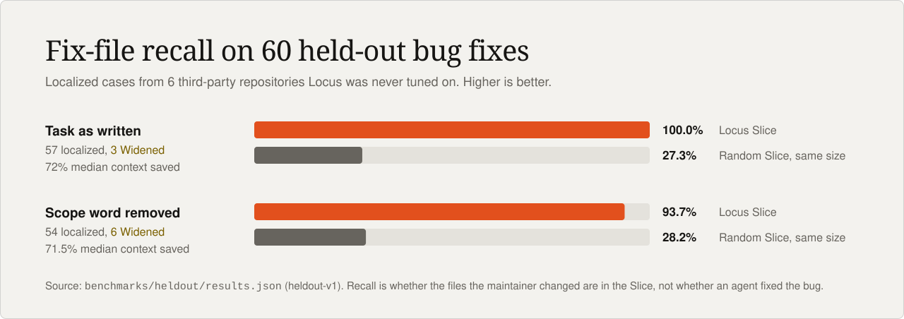

<div align="center">

# Locus

**Give your coding agent focused context. Keep the final say.**

[Open Locus](https://locus-five-iota.vercel.app/workspace) · [Review the change](#review-the-change) · [Quick start](#quick-start) · [Measured results](#measured-results) · [CLI and MCP](#use-it-from-an-agent)

[](https://github.com/taranggoyal70/locus/actions/workflows/ci.yml)
[](benchmarks/heldout/README.md)
[](LICENSE)
[](https://locus-five-iota.vercel.app)

<picture>
  <source media="(max-width: 600px) and (prefers-color-scheme: dark)" srcset="assets/readme/hero-mobile-dark.svg">
  <source media="(max-width: 600px)" srcset="assets/readme/hero-mobile-light.svg">
  <source media="(prefers-color-scheme: dark)" srcset="assets/readme/hero-dark.svg">
  
</picture>

</div>

Start with a task and a repository. Locus builds an import graph and selects a **Slice**: matching files,
their dependencies, direct consumers and relevant recent changes. Every included file has a reason; every
excluded file stays visible. Weak evidence makes Locus **widen** to the whole loaded repository and return
terms that can help refine the task. Localization is deterministic and makes **no model calls**.

In the web workspace, an Agent Run can turn that context into a proposed change. You get the diff, check
output and recorded usage, then answer **“Did the agent do what you asked?”** against your own goals.
Approve or reject the exact proposal. Download its patch to try it locally before deciding, or take the
approved change into your own checkout. Locus does not push it to GitHub.

For agents you run yourself, **Locus Guard** adds a separate CLI workflow: constrain target-repository access,
check the candidate's changed paths, and bind execution evidence and human review into an Ed25519-signed
receipt. A valid signature establishes integrity and provenance; the reviewer decides whether the change is right.

Use the hosted workspace, REST API, or the local **CLI and MCP server**. The localizer supports JavaScript,
TypeScript, Python, and imports inside Vue, Svelte and Astro components.

## What you get

Follow the workflow: find the code, inspect why it belongs, check the evidence, and hand the context to your agent.

### 01 · Localize a public repository

<picture>
  <source media="(max-width: 600px) and (prefers-color-scheme: dark)" srcset="assets/readme/feature-localize-mobile-dark.svg">
  <source media="(max-width: 600px)" srcset="assets/readme/feature-localize-mobile-light.svg">
  <source media="(prefers-color-scheme: dark)" srcset="assets/readme/feature-localize-dark.svg">
  
</picture>

A task becomes Anchors, dependencies and a focused Slice. This replays the recorded jotai result used in the hero. [Open the workspace](https://locus-five-iota.vercel.app/workspace).

### 02 · Inspect why a file belongs

<picture>
  <source media="(max-width: 600px) and (prefers-color-scheme: dark)" srcset="assets/readme/feature-inspect-mobile-dark.svg">
  <source media="(max-width: 600px)" srcset="assets/readme/feature-inspect-mobile-light.svg">
  <source media="(prefers-color-scheme: dark)" srcset="assets/readme/feature-inspect-dark.svg">
  
</picture>

Every square is a file. Hovering one reveals its path, its role and the imports connected to it. This replays the website’s recorded taxonomy example: **14 of 125 files**, with `components/editor.tsx` as an Anchor. [Explore the interactive map](https://locus-five-iota.vercel.app/#try).

### 03 · Explore the evidence, case by case

<picture>
  <source media="(max-width: 600px) and (prefers-color-scheme: dark)" srcset="assets/readme/feature-cases-mobile-dark.svg">
  <source media="(max-width: 600px)" srcset="assets/readme/feature-cases-mobile-light.svg">
  <source media="(prefers-color-scheme: dark)" srcset="assets/readme/feature-cases-dark.svg">
  
</picture>

Pick a repository and inspect a real fix. The case view shows the original task, the admitted files and whether the maintainer’s changed file was found. **All 60 selected fixes across six third-party repositories are reported**, including widened cases. These are localization results; agent completion is a separate study. [Inspect every case](https://locus-five-iota.vercel.app/evidence/release-1#cases).

### 04 · Hand the context to your agent

<picture>
  <source media="(max-width: 600px) and (prefers-color-scheme: dark)" srcset="assets/readme/feature-handoff-mobile-dark.svg">
  <source media="(max-width: 600px)" srcset="assets/readme/feature-handoff-mobile-light.svg">
  <source media="(prefers-color-scheme: dark)" srcset="assets/readme/feature-handoff-dark.svg">
  
</picture>

Choose Generic, Claude or Cursor, copy the Slice, and bring the brief into your own coding tool. The replay uses the website's taxonomy example: **14 files and 6,448 estimated tokens**. [Try the handoff](https://locus-five-iota.vercel.app/#try). For programmatic use, see the [API and MCP interfaces](#use-it-from-an-agent).

[Visual sources and replay behavior](assets/readme/README.md). The cursor movements replay the product’s interactions; the committed data supplies the files and results.

## Review the change

<picture>
  <source media="(max-width: 600px) and (prefers-color-scheme: dark)" srcset="assets/readme/review-mobile-dark.svg">
  <source media="(max-width: 600px)" srcset="assets/readme/review-mobile-light.svg">
  <source media="(prefers-color-scheme: dark)" srcset="assets/readme/review-dark.svg">
  
</picture>

*A repeating illustration of the shipped review and patch-download workflow. It does not represent an
executing agent or a newly completed task.*

1. **Inspect what changed.** A proposal carries a frozen candidate, a diff and check output. Checks are repeated
   against the frozen candidate in a clean verification workspace before the proposal reaches review.
2. **Decide in plain language.** Read the change, tick every goal it meets, and choose **Approve change** or
   **Reject change**. The saved review binds to that proposal's hash; passing checks alone do not accept it.
3. **Try it in your own checkout.** **Download change** produces a patch and commands to apply it on a new
   branch from the recorded base commit. Download is available during review and after acceptance. Rejected,
   failed or integrity-mismatched proposals have no download.

If a Run stops after making edits, **Unpublished change** preserves its diff and check output for inspection.
It cannot be accepted or downloaded. Run artifacts are retained for 30 days.

The implementation is inspectable: [review UI](src/components/ProposalReview.tsx),
[availability rules](src/lib/agent/run-review.ts), [patch construction](src/lib/agent/proposal-patch.ts),
and the [authenticated download endpoint](src/app/api/agent/runs/%5Bid%5D/patch/route.ts).

## Measured results

| Question | Result | Held out how |
| :--- | :--- | :--- |
| Does the Slice contain the files a maintainer changed, on code Locus has never seen? | **60/60 cases** with every fix file in the Slice. On the 57 cases Locus localized, a **72% median** estimated context reduction; a random Slice of the same size would have contained **27.3%** of the fix files. | Six third-party repositories pinned on 2026-11-19, ten most recent qualifying fix commits each, chosen by a written rule and all scored. [Report](benchmarks/heldout/README.md) |
| How much of that depends on the task naming the module? | With the conventional-commit scope removed from every task: **94.4%** fix-file recall, **57/60** complete cases, **6** widened, 71.5% median reduction on localized cases. | The same 60 cases. This ablation was added after the first run, to test it. |
| Does it still work on the project's own history? | **15/15** cases, 53% median reduction, 2 widened. | Not held out: fixes from repositories this project's author owns, gated on full recall. [Suite](benchmarks/README.md) |
| Does a Slice cut total agent tokens without lowering accepted work? | **Not measured yet.** 0 of 40 arm results are recorded, so the gate stays locked and no outcome is claimed. | Frozen paired study with blinded human review. [Protocol](benchmarks/release1/README.md) |

<picture>
  <source media="(max-width: 600px) and (prefers-color-scheme: dark)" srcset="assets/readme/heldout-mobile-dark.svg">
  <source media="(max-width: 600px)" srcset="assets/readme/heldout-mobile-light.svg">
  <source media="(prefers-color-scheme: dark)" srcset="assets/readme/heldout-dark.svg">
  
</picture>

### How the held-out benchmark is built

The historical suite replays fixes from the author's own repositories and fails the build unless every fix file
is found, so it can only ever report 100%. It is a regression gate, not evidence. The held-out benchmark was
written to be the opposite: [`benchmarks/heldout/protocol.json`](benchmarks/heldout/protocol.json) freezes six
TypeScript repositories (honojs/hono, pmndrs/zustand, pmndrs/jotai, h3js/h3, sindresorhus/ky and trpc/trpc) at
fixed commits, and excludes two repositories that were used while developing the resolver. From each, it takes
the ten most recent first-parent commits whose subject starts with "fix" and that modify one to three non-test
source files. The task is the commit subject, mechanically cleaned. Locus runs on the parent snapshot exactly as
the CLI does, and every selected case is reported: the three that widen, and in the ablation the six that widen
and the three that miss a file.

<details>
<summary>What these numbers do and do not show</summary>

- **Recall is not task success.** It says the files a maintainer changed are in the Slice. It does not say an
  agent given that Slice would have fixed the bug, or that every excluded file was unnecessary. The Release 1
  study exists to measure that, and it has not run.
- **Widened cases score full recall by definition** and save nothing. They are counted, and reported separately.
- **Slices are not tiny.** The median localized Slice is 102,159 estimated tokens against a median repository of
  419,031. That is above the 40,000-token default budget for `--pack`, which ranks anchors first and truncates.
- **Token counts are estimates**: Locus's `chars / 4`, not a model tokenizer.
- **Commit subjects are terse and carry no error text.** Real tasks with `--evidence` usually give the matcher
  more to work with; scoped subjects can give it less work than a vague human request.
- **One language family.** All six held-out repositories are TypeScript. Python support is tested but not
  benchmarked here.

Reproduce with `pnpm benchmark:heldout` (clones about 180 MB of public repositories into your temp directory)
and `pnpm benchmark`. Both are deterministic: rerunning them on 2026-11-19 reproduced every committed number.

</details>

## How it works

<picture>
  <source media="(max-width: 600px) and (prefers-color-scheme: dark)" srcset="assets/readme/architecture-mobile-dark.svg">
  <source media="(max-width: 600px)" srcset="assets/readme/architecture-mobile-light.svg">
  <source media="(prefers-color-scheme: dark)" srcset="assets/readme/architecture-dark.svg">
  
</picture>

*Architecture illustration. The hosted proposal and CLI Guard paths remain distinct.*

1. **Build the graph.** [`buildGraph`](src/lib/localizer.ts) parses `import`, `require()`, dynamic `import()`,
   tsconfig `paths` and `baseUrl`, NodeNext `.js` specifiers that point at `.ts` files, monorepo workspace
   package names, and Python `import` / `from ... import` into a dependency graph. Third-party packages are never
   edges, and a sparse graph is flagged so a reduction figure is not overstated.
2. **Anchor the task.** [`locate`](src/lib/localizer.ts) scores every file against the task's words through its
   path, source text, Next.js route and recent-change history, and initially selects up to six anchors.
   A selected test file also pulls in the implementation it covers, so the final anchor set can be larger.
3. **Close over dependencies.** Each anchor brings its import closure and its direct consumers; anchors rank first
   so they survive a token budget.
4. **Widen when unsure.** If the best anchor is weak, the whole repository comes back with the unmatched terms,
   candidate files and repository vocabulary to refine the task.
5. **Contain and sign.** [`locus guard`](bin/guard.mjs) turns the Slice into a manifest, runs the agent against
   only those files in an OS sandbox, rejects any candidate that changes a path outside them, and signs the
   result ([ADR 0003](docs/adr/0003-guard-trusts-an-external-manifest-hash.md),
   [ADR 0004](docs/adr/0004-runner-enforces-a-target-repo-boundary.md)).

The hosted Agent path runs the same localizer, then executes a bounded agent loop in a Vercel Sandbox under a
durable Vercel Workflow. It requires a changed candidate and recorded checks, verifies the frozen bytes in a
clean workspace, and presents the proposal for human review. Acceptance completes the Run; the owner applies
the downloaded patch locally. External GitHub writes are disabled.

[`bin/core.mjs`](bin/core.mjs) is a dependency-free port of the localizer for the local CLI and MCP server;
a [parity test](tests/localizer-parity.test.mjs) checks them against the same inputs.

### Engineering decisions

| Constraint | Approach | Tradeoff |
| :--- | :--- | :--- |
| An agent cannot tell what a small Slice left out, so a confident wrong Slice is worse than a large one. | Widen to the whole repository below a fixed anchor score, and return the terms that matched nothing plus suggested starting files. | A widened run saves nothing: 3 of 60 held-out cases, 6 without scope words. |
| A Slice has to be explainable and reproducible to be reviewed. | Localization is lexical scoring over a parsed import graph: no embeddings and no model calls, so the same input gives the same Slice. | It misses synonyms the code never uses; removing scope words drops held-out recall to 94.4%. |
| An agent with filesystem access can rewrite its own allowlist. | Guard trusts a manifest hash and candidate SHA supplied from outside the branch, and fails closed without them. | CI has to carry the hash out of band; a signature proves provenance and integrity, not correctness. |
| An agent with host access can read the whole repository before the final check. | `guard run` copies the Slice into an ephemeral workspace and runs the agent under macOS Seatbelt or Linux Bubblewrap, refusing if neither exists. | The network is not isolated, and other host-readable data is not concealed. |
| Opening sign-up exposes shared model capacity to the internet. | Each account resolves to one Tier; self-serve needs the exact word `open`, a verified email and an account ceiling; capabilities ship through `CAPABILITY_RELEASE` in code. | Releasing a capability is a reviewed commit, never a dashboard toggle. |
| Stripe delivers webhooks out of order and retries only on failure. | A database function refuses stale or duplicate events in the same statement as the write; the route returns 500 only when the write itself failed. | Billing is withheld in this release, so the path is tested but not exercised by real payments. |

### Technology

| Layer | Used for |
| :--- | :--- |
| **Web app** | Next.js 16 App Router, React 19, Tailwind CSS v4, Vercel Analytics and Speed Insights |
| **Identity and data** | Clerk sessions and email verification; Neon Postgres through Kysely, 23 migrations, a tenant guard on every per-user query |
| **Agent Runs** | Vercel Workflow for durable Runs, Vercel Sandbox for isolated execution, AI SDK against Cloudflare Workers AI |
| **Task evidence** | `unpdf`, `mammoth` and `tesseract.js` extract text from PDFs, DOCX files and screenshots |
| **CLI, MCP and Guard** | Zero-dependency Node ESM; stdio JSON-RPC for MCP; `node:crypto` Ed25519; Seatbelt and Bubblewrap |
| **Billing** | Stripe Checkout and webhooks, withheld by `CAPABILITY_RELEASE` |
| **Verification** | Vitest, Testing Library and jsdom; real CLI and MCP process tests; CodeQL, gitleaks and `pnpm audit` in CI |

## Quick start

The **local CLI and MCP server need only Node.js 22 or newer**. No dependency installation, account, model
key or network request is needed to localize an existing checkout.

```bash
git clone https://github.com/taranggoyal70/locus.git
cd locus
node bin/locus.mjs locate "stripe webhook should retry when the subscription write fails"
```

That command localizes this checkout and prints the anchors, included files, dependency distances, excluded
count and estimated context size. Its result changes with the code and recent-change history. Add `--pack`
for a context block or `--json` for structured output.

For the web app, install **pnpm 11** (`corepack enable`), run `pnpm install --frozen-lockfile`, and configure
the services below before starting `pnpm dev`.

| Mode | Command | What runs |
| :--- | :--- | :--- |
| Localize a checkout | `node bin/locus.mjs locate "<task>" --path <dir>` | The full localizer on your machine. Add `--pack`, `--json` or `--evidence`. |
| MCP server | `node bin/locus.mjs mcp` | A stdio server exposing `locate` to Claude Code, Codex or Cursor. |
| Guard a Run | `node bin/locus.mjs guard init "<task>"`, then `guard run` and `guard verify` | Scope manifest, sandboxed agent, path gate and signed receipt. [Pilot guide](docs/operations/locus-guard-pilot.md) |
| Hosted API | `curl -X POST https://locus-five-iota.vercel.app/api/v1/locate` | Localization of a public GitHub repository with an API key from Settings. |
| Web app | `pnpm dev` | The full product on `localhost:3000`. Needs Clerk keys and a Postgres URL; see [Configuration](#configuration). |

Any PostgreSQL 15 or newer works as the database: a Neon branch, or a local server. Put its URL in
`DATABASE_URL` in `.env.local`, then apply the migrations:

```bash
pnpm db:migrate   # applies what is new, records each file and its checksum, refuses an edited one
```

The same command migrates production; see the [database runbook](docs/operations/neon-database.md).

## Use it from an agent

| Command | Does |
| :--- | :--- |
| `locus locate "<task>"` | Prints anchors, the Slice with distance and token estimates, and the excluded count |
| `locus locate "<task>" --pack --budget 40000` | Emits a token-bounded, ready-to-paste context block |
| `locus locate "<task>" --json` | The machine-readable result; file fields are relative to `dir` |
| `locus locate "<task>" --evidence "<stack trace>"` | Adds error text to the matcher |
| `locus mcp` | Starts the MCP server: `locate(task, path?, evidence?, pack?)` |
| `locus guard init "<task>"` | Writes a scope manifest and prints its SHA-256 to keep outside the branch |
| `locus guard widen <path> --reason "<why>" --actor "<who>"` | Appends a hash-chained Widen event |
| `locus guard run --agent <codex\|claude\|command> ...` | Runs the agent against the Slice in an OS sandbox |
| `locus guard verify --expected-manifest-hash <sha> --expected-candidate-sha <oid>` | Fails if the candidate changes a path outside the Slice |
| `locus guard review` / `locus guard receipt verify` | Binds an immutable human review; verifies a signed receipt |

`locus` here is `node bin/locus.mjs` from a checkout; no npm package is published. To use the MCP server from
Claude Code or Cursor, point the client at the checkout:

```json
{
  "mcpServers": {
    "locus": {
      "command": "node",
      "args": ["/path/to/locus/bin/locus.mjs", "mcp"],
      "env": { "LOCUS_MCP_ROOTS": "/path/to/your/repo" }
    }
  }
}
```

The server only reads directories inside `LOCUS_MCP_ROOTS` (default: its working directory), compared after
resolving symlinks, so a client cannot widen what it may read.

The REST API takes `repo` (`owner/repo`, `owner/repo@ref` or a GitHub URL), `task`, and optional `evidence` and
`budget`, and returns `slice`, `anchors`, `tokens`, `graph`, packed `context` and `refinement`:

```bash
curl -X POST https://locus-five-iota.vercel.app/api/v1/locate \
  -H "Authorization: Bearer $LOCUS_API_KEY" \
  -H "Content-Type: application/json" \
  -d '{"repo": "pmndrs/jotai", "task": "subscriber not notified after nested store.set"}'
```

Rate limit: 30 requests a minute per user. Full reference: [/docs](https://locus-five-iota.vercel.app/docs).

## Configuration

For a complete hosted deployment, copy [`.env.example`](.env.example) to `.env.local`. The web app reports which
production dependencies are missing at
[`/api/health`](https://locus-five-iota.vercel.app/api/health).

The local `bin/` CLI needs none of these service credentials. The web workspace uses Clerk and Postgres;
Agent Runs additionally need the reviewed Cloudflare route and credential encryption. Retention and alerting
are production-readiness requirements.

| Variable | Required | Purpose |
| :--- | :---: | :--- |
| `NEXT_PUBLIC_CLERK_PUBLISHABLE_KEY`, `CLERK_SECRET_KEY` | Yes | Clerk sign-in, sessions and email verification |
| `DATABASE_URL` | Yes | Postgres for Tasks, Runs, evidence, API keys and usage; on Neon, the pooled connection string |
| `DATABASE_URL_UNPOOLED` | No | A direct connection for `pnpm db:migrate`; falls back to `DATABASE_URL` |
| `LOCUS_AGENT_MODEL` | Yes | Must be the reviewed `@cf/qwen/qwen3.8-27b`; any other value fails closed |
| `CLOUDFLARE_ACCOUNT_ID`, `CLOUDFLARE_API_TOKEN` | Yes | The shared Workers AI pool for Agent Runs |
| `LOCUS_CREDENTIAL_ENCRYPTION_KEY` | Yes | Base64 32-byte key that encrypts users' own Cloudflare tokens |
| `CRON_SECRET` | Yes | Authorizes the daily retention job in `vercel.json` |
| `OPS_EXTERNAL_HEALTHCHECK` or `OPS_ALERT_WEBHOOK_URL` | One | Operational alerting: `github_actions` for the committed monitor, or an HTTPS webhook |
| `ALPHA_ALLOWED_USER_IDS` | No | Clerk user IDs admitted to the comped `partner` Tier |
| `LOCUS_SELF_SERVE`, `LOCUS_SELF_SERVE_MAX_ACCOUNTS` | No | `open` admits verified accounts to the `free` Tier, up to an optional ceiling |
| `LOCUS_SHARED_DAILY_RUN_LIMIT` | No | Shared Runs the deployment admits per UTC day across all accounts; 1 to 100, default 1. Each account still gets at most one |
| `LOCUS_OWNER_USER_IDS` | No | Clerk user IDs of the operators, whose shared Runs skip both daily limits |
| `LOCUS_RUN_TOKEN_BUDGET` | No | Token budget for Runs on a user's own credentials; 10,000 to 240,000, default 180,000 |
| `LOCUS_API_ALLOWED_ORIGINS` | No | Browser origins allowed to call the REST API with CORS |
| `GITHUB_TOKEN` | No | Higher GitHub API limits when importing public repositories |
| `GITHUB_CLIENT_ID`, `GITHUB_CLIENT_SECRET` | No | GitHub OAuth; inert while the capability is withheld |
| `STRIPE_SECRET_KEY`, `STRIPE_WEBHOOK_SECRET`, `STRIPE_PRO_PRICE_ID` | No | Billing; inert while the capability is withheld |
| `NEXT_PUBLIC_SITE_URL`, `NEXT_PUBLIC_SUPPORT_URL` | No | Public URLs; detected automatically on Vercel |

The CLI reads `LOCUS_MCP_ROOTS`, `LOCUS_GUARD_SIGNING_KEY` and `LOCUS_GUARD_SIGNER_KEY_ID`; the template
documents them too.

<details>
<summary>Admission and Tiers</summary>

Every signed-in account resolves to one **Tier**, which sets what it may do and how many Agent Runs it may hold.

| Tier | How it is reached | Runs (active / rolling 24 hours) | Public Repos | Non-public Repos | PR delivery |
| :--- | :--- | :---: | :---: | :---: | :---: |
| `visitor` | Signed out, waitlisted or suspended | 0 / 0 | read only | no | no |
| `free` | A verified email while `LOCUS_SELF_SERVE=open` and below the ceiling | 1 / 2 | yes | no | no |
| `partner` | Listed in `ALPHA_ALLOWED_USER_IDS` | 2 / 10 | yes | yes | yes |
| `pro` | An active Stripe subscription | 5 / 50 | yes | yes | yes |

The highest matching Tier wins, and an operator row in `account_admissions` can raise or refuse an account. The
table is the ladder as designed; `CAPABILITY_RELEASE` in [`src/lib/admission.ts`](src/lib/admission.ts) is what
has shipped, and the two are intersected. Today it withholds GitHub connections, non-public Repos, teams, PR
delivery and billing for every Tier.

</details>

## Verify a checkout

```bash
pnpm install --frozen-lockfile
pnpm lint && pnpm typecheck && pnpm test     # no provider keys; local servers and OS sandbox tests
pnpm check:merge-markers && pnpm check-sync && pnpm check:alpha-claims
pnpm evidence:release1                       # the public study report matches its inputs
pnpm readme:assets --check                   # the README graphics match their data
pnpm benchmark                               # historical gate (network for two repos)
pnpm benchmark:heldout                       # held-out benchmark (network, about 180 MB)
```

CI runs everything above except the two benchmarks, plus a production build, an audit of every dependency at
high severity, CodeQL and a full-history secret scan. A scheduled workflow probes the production
`/api/health` contract every five minutes.

Database tests need no setup. Each one gets its own in-process PostgreSQL (PGlite) with every migration
applied, so routes, SQL functions and constraints are tested against the real schema on every run.
`pnpm db:types` regenerates the query types from the migrations, and CI fails when they are stale.

```text
src/lib/localizer.ts        Graph construction, anchor scoring, closure and Widen
src/lib/admission*.ts       Tiers, self-serve barriers and the capability release record
src/lib/agent/              Agent Run lifecycle, budgets, quotas, Sandbox workspace and verification
src/workflows/agent-run.ts  The durable Workflow behind each Agent Run
src/app/                    Product pages, workspace and every API route
bin/                        Source CLI, MCP server and Locus Guard (core.mjs mirrors the localizer)
cli/                        The thin API client package, not published
db/migrations/              23 append-only migrations, applied by db/migrate.mjs
src/lib/db/                 Postgres client, tenant guard and types generated from the migrations
benchmarks/                 Historical gate, held-out benchmark and the frozen Release 1 study
scripts/                    Benchmarks, release evidence, launch probes and README graphics
docs/adr/, CONTEXT.md       Architecture decisions and the domain language
```

## Status and limits

- **Public beta.** Any verified account can localize a public repository. Each account gets one shared Agent Run
  per UTC day while the daily pool lasts, or can connect its own Cloudflare account. Non-public Repos, GitHub writes and billing are
  withheld in code.
- **Task success is unmeasured.** The benchmarks above measure whether the right files are in the Slice. Whether
  an agent finishes more tasks, or spends fewer total tokens per accepted task, waits on the Release 1 study.
- **Lexical matching.** A task that uses none of the code's vocabulary widens or misses; `--evidence` and the
  refinement terms are the remedy.
- **Import limits depend on the surface.** The web workspace previews up to 500 supported source files and
  3.8 MB; the REST API caps imports at 200 files and 5 MB. The local CLI and MCP server in `bin/` read the
  checkout directly and do not inherit the API's 200-file cap. The separate HTTP client in `cli/` sends selected
  source to the API and does inherit its limits. Neither client is published to npm.
- **Agent Runs require runnable checks.** A repository needs a supported JavaScript or TypeScript test, lint,
  typecheck or build command. Python-only repositories can be localized; hosted Python execution is not supported.
- **Guard containment** covers macOS and Linux only, does not isolate the network, and proves which files changed,
  not that the change is right.
- **Uploaded evidence** is processed for text and not intentionally retained, but extracted text becomes part of
  a Run record once submitted.

[Domain language](CONTEXT.md) · [Architecture decisions](docs/adr) · [Guard pilot](docs/operations/locus-guard-pilot.md) · [Security review status](docs/operations/security-review-status.md) · [Changelog](CHANGELOG.md)

## Contributing and security

Read [CONTRIBUTING.md](CONTRIBUTING.md) before opening a change; outside contributions need a written agreement
first. Report vulnerabilities privately through [SECURITY.md](SECURITY.md), never in a public issue.

## License

Copyright © 2026 Tarang Goyal. All rights reserved.

Locus is **source-available, not open source**. The code is public so it can be read, evaluated and checked
against the results above. No right to use, copy, modify, distribute, sublicense or sell any part of it is
granted; see [LICENSE](LICENSE). Third-party dependencies keep their own licenses. For commercial terms, get in
touch.
